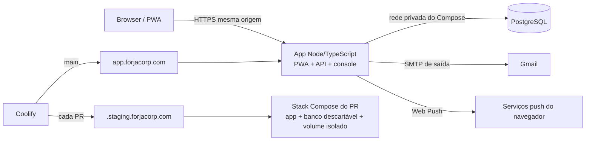

# Contrato do backend e do primeiro deploy — v1

**Estado:** decisões aprovadas para o piloto privado. API, migrações, gateways de produção e imagem Docker estão no repositório; a implantação de produção e os previews do Coolify ainda precisam ser configurados e verificados.

## Fontes de verdade

- [Modelagem residencial](./modelagem-mobile-v1.md): jornadas e regras observáveis do produto.
- [Contrato administrativo](./admin-backend-contract.md): console, dados administrativos, métricas e operações.
- Este documento: arquitetura, autenticação, integração entre cliente e servidor, privacidade operacional e deploy.

Não copiar para este documento regras de interface, recorrência ou métricas já definidas nas fontes acima. Se uma decisão mudar, editar sua fonte de verdade e atualizar apenas referências que ficaram desatualizadas.

## Decisões do piloto

| Tema | Decisão |
| --- | --- |
| Finalidade | Piloto privado para uma casa; cadastro público permanece fechado. |
| Hospedagem | Coolify self-hosted já existente; PostgreSQL e app no servidor atual, sem serviço pago adicional. |
| Arquitetura | Um recurso Docker Compose do Git inicia dois serviços privados: Node/TypeScript (PWA + API) e PostgreSQL. Só o app recebe domínio público; o banco fica na rede privada do Compose. |
| Produção | `main` publica em `https://app.forjacorp.com`. |
| Pré-visualização | Coolify cria um preview para cada PR em `https://<número>.staging.forjacorp.com`; não existe instância fixa de staging nem branch permanente `staging`. Cada preview usa banco descartável e isolado. |
| Identidade inicial | A conta de acesso do responsável será uma única identidade com papel administrativo e residencial. O endereço usado para login fica somente na configuração privada do Coolify. Ambos usam a mesma senha; a área admin também exige TOTP. A casa começa sem dados, para validar o cadastro e a criação da casa pelo fluxo normal. |
| Login residencial | E-mail e senha; e-mail precisa ser verificado. Cadastro só por autorização ativa ou convite válido. |
| Login administrativo | E-mail e senha mais TOTP obrigatório; códigos de recuperação de uso único são exibidos uma vez e guardados pelo administrador fora do servidor. |
| E-mail transacional | Gmail SMTP autenticado por uma conta configurada privadamente no Coolify, com verificação em duas etapas e senha de app guardada nos segredos do Coolify. O usuário SMTP não é publicado neste repositório. |
| Notificações | Push diário de tarefas e avisos dentro do app conforme a modelagem residencial; a permissão é por dispositivo. |
| Backup | PostgreSQL diário no servidor, retenção de 30 dias, mais cópia manual criptografada semanal no computador do responsável. Quatro cópias semanais são mantidas e rotacionadas. |
| Retenção operacional | Eventos de uso sem conteúdo doméstico: 90 dias. Auditoria administrativa: 12 meses. E-mails da outbox que falharem 10 tentativas: removidos após 7 dias. Backups locais e cópias externas: no máximo 30 dias. |
| Exportação e exclusão | Exportação JSON iniciada no perfil. Exclusão de conta iniciada no perfil, preservando histórico compartilhado de forma anonimizada; casa sem outros moradores é apagada junto. |
| Controlador e contato | Usar a grafia registrada no CNPJ do MEI: `65.086.651 VINICIUS MORAES VALENCA VARJAO`; marca ForjaCorp; contato `forjacorp@gmail.com`. Não foi indicado outro formato. |

## Variáveis do serviço

Coolify injeta estas variáveis no runtime; nenhum segredo vai para o Git ou para variáveis `VITE_*`. O [Compose do repositório](../docker-compose.yml) é a fonte de configuração dos serviços, da origem pública e da conexão privada com o banco.

O e-mail de login do responsável e o usuário SMTP são configuração privada: informar diretamente no Coolify e não registrá-los em código, documentação pública, issues, logs ou capturas de tela. `forjacorp@gmail.com` é o contato público do serviço, não o e-mail de login. Arquivos `.env*` ficam fora do Git.

| Variável | Produção | Preview | Observação |
| --- | --- | --- | --- |
| `APP_STAGE` | `production` | `preview` | Define quais integrações são obrigatórias no início do serviço. |
| `APP_ORIGIN` | `COOLIFY_URL` (com fallback para `https://app.forjacorp.com`) | URL HTTPS do próprio PR, fornecida por `COOLIFY_URL` | Usada em links, validação de origem e cookies. |
| `POSTGRES_PASSWORD` | Segredo de produção no Coolify | Segredo separado, sem credencial de produção | Use valor hexadecimal para formar a URL PostgreSQL sem ambiguidades. O Compose deriva `DATABASE_URL` e injeta a mesma senha no serviço do banco. |
| `DATABASE_URL` | Derivada pelo Compose para o PostgreSQL persistente | Derivada pelo Compose para o PostgreSQL descartável do PR | Não configurar ou compartilhar URL externa entre ambientes. O serviço `database` não publica porta. |
| `ENCRYPTION_KEY` | Obrigatória, privada | Obrigatória, separada da produção | 32 bytes codificados em Base64; protege TOTP, assinatura push e links em outbox. Perder a chave impede descriptografar esses dados. |
| `SMTP_USER` | Configurada privadamente no Coolify | Omitida | Conta autorizada a enviar e-mail transacional; não registrar o valor no repositório público. |
| `SMTP_APP_PASSWORD` | Obrigatória | Omitida | Senha de app do Gmail, secreta no Coolify. |
| `SMTP_FROM` | Opcional | Omitida | Por padrão usa `SMTP_USER`; só definir remetente alternativo se ele estiver autorizado no Gmail. |
| `VAPID_PUBLIC_KEY`, `VAPID_PRIVATE_KEY` | Obrigatórias | Omitidas | Par exclusivo de produção; chave privada fica apenas no servidor. |
| `VAPID_SUBJECT` | Opcional | Omitida | Padrão `mailto:forjacorp@gmail.com`. |
| `BOOTSTRAP_ADMIN_EMAIL` | Temporária: definida privadamente no Coolify até criar o primeiro admin | Omitida | Remover depois do provisionamento. Sem ela, a instalação vazia não oferece bootstrap administrativo. Não registrar o valor no repositório público. |
| `PORT` | `3000` | `3000` | Porta escutada pelo contêiner. |
| `DATABASE_POOL_SIZE` | Opcional, padrão `10` | Opcional, padrão `10` | Limite de conexões do serviço. |
| `DATABASE_SSL` | Opcional | Opcional | Use `true` somente se o PostgreSQL exigir TLS com certificado confiável. |

Em `NODE_ENV=production`, o serviço recusa iniciar quando faltam `APP_ORIGIN`, `DATABASE_URL` ou `ENCRYPTION_KEY`; também exige SMTP e VAPID quando `APP_STAGE=production`. O domínio deve usar HTTPS. Previews usam `APP_STAGE=preview`, credencial de banco e chave de criptografia não produtivas, sem enviar e-mail ou push. Os valores de Preview Deployment ficam no grupo de preview do Coolify; não copiar ali variáveis da produção.

## Arquitetura de runtime

- A API fica sob `/api`; as rotas administrativas HTTP usam `/api/admin`. `/admin` continua sendo a rota da interface. Isso evita colisão entre rotas do React e endpoints.
- A API residencial usa `/api/auth`, `/api/me`, `/api/households/:id/...` e `/api/push`. Cada chamada valida sessão, papel residencial ativo e vínculo ativo com a casa no servidor.
- A PWA pública e o console de produção são servidos pelo mesmo app. O build público inclui o console somente quando ele estiver conectado ao backend real; as fixtures e o gateway demo nunca são incluídos.
- PostgreSQL não recebe tráfego público. O app se conecta pelo nome do serviço na rede privada do Compose. O volume nomeado é persistente na produção; Coolify isola o volume por PR e o remove com o preview. O volume não substitui backups.
- Coolify publica produção a partir de `main`. Preview deployments são habilitados para membros do repositório; previews de forks públicos ficam desligados. Ao fechar ou mesclar o PR, o Coolify remove o preview.
- Cada preview tem containers, rede e volume de banco isolados, com dados sintéticos descartáveis. Variáveis de produção não são passadas aos previews; usar uma credencial e uma chave de criptografia exclusivas do grupo de preview. Não recebe backup, e-mails, assinaturas push ou dados de produção. Envio de e-mail e push fica desativado nos previews.
- A URL de preview não é uma barreira de acesso. Usar apenas dados sintéticos e não publicar links/token de teste com acesso a produção.
- O domínio gerado por PR requer DNS curinga `*.staging.forjacorp.com` apontando ao servidor. Coolify permite domínio por PR e separa variáveis de produção e de preview; confira a configuração atual antes de alterar DNS ou recursos. [Previews do Coolify](https://coolify.io/docs/applications/deployments/preview-deployments)

## Contas, sessões e segurança

- `accounts` é a identidade canônica: e-mail normalizado, hash de senha e confirmação do e-mail. `users` e `platform_admins` são papéis separados ligados à mesma identidade; ter um papel não concede automaticamente o outro. A mesma identidade pode acumular os dois papéis.
- O primeiro admin é criado uma única vez em uma instalação vazia. `BOOTSTRAP_ADMIN_EMAIL` fica no Coolify. Em `/admin/setup`, solicitar um link de uso único enviado só para esse e-mail; o token expira em 30 minutos, é armazenado como hash e não aparece em logs. A pessoa define a senha (ou confirma a senha residencial já existente) e registra TOTP; após concluir, remover `BOOTSTRAP_ADMIN_EMAIL` e desativar o bootstrap. Não há senha inicial em código, fixture ou conversa.
- Para vincular o papel residencial à identidade admin, autorizar o mesmo e-mail no console e concluir o cadastro residencial com a mesma senha. Como o bootstrap já confirmou o endereço, o cadastro residencial pode abrir a sessão sem enviar uma segunda confirmação. A casa ainda é criada pelo fluxo normal em `/criar-casa`; não há casa nem conteúdo inicial pre-semeado.
- Convite/autorização, verificação de e-mail, recuperação de senha e convite residencial usam tokens aleatórios de uso único. O banco armazena somente hashes dos tokens, com expiração e consumo atômico. O fluxo não confirma publicamente se um e-mail já possui conta.
- Tokens de verificação expiram em 24 horas; redefinição de senha, em 1 hora; convites seguem os 7 dias já definidos no contrato administrativo. O token de bootstrap é temporário e removido imediatamente após o primeiro admin.
- Senhas são armazenadas com `scrypt` da biblioteca padrão do Node e salt próprio; nunca em texto ou criptografia reversível. Usar `N=2^17`, `r=8` e `p=1`, parâmetros mínimos indicados pelo OWASP quando Argon2id não estiver disponível. [OWASP Password Storage](https://cheatsheetseries.owasp.org/cheatsheets/Password_Storage_Cheat_Sheet.html)
- Sessões usam tokens opacos aleatórios, guardados no banco apenas como hash, e cookies distintos para admin e morador: `Secure`, `HttpOnly`, `SameSite=Lax`, `Path=/` e sem atributo `Domain`. Requisições que alteram dados validam a origem. Não guardar sessão ou senha em `localStorage`.
- A sessão residencial expira após 30 dias; a administrativa após 8 horas. A senha é única por identidade; redefini-la pelo fluxo residencial revoga as sessões residencial e administrativa. Suspensão revoga somente a sessão residencial. Mudanças administrativas são auditadas sem conteúdo doméstico.
- Aplicar rate limit a login, cadastro, verificação, recuperação, convite e TOTP. Respostas de erros não revelam existência de e-mail. Autorizar no servidor cada ação e cada casa; negar por padrão.
- TOTP é obrigatório em toda conta administrativa. O segredo TOTP fica criptografado no servidor; códigos de recuperação ficam armazenados como hashes e só podem ser usados uma vez. O OWASP recomenda MFA para contas administrativas. [OWASP MFA](https://cheatsheetseries.owasp.org/cheatsheets/Multifactor_Authentication_Cheat_Sheet.html)
- Se todos os códigos de recuperação forem perdidos, a única recuperação é uma ação manual, auditada e feita no servidor após confirmar a identidade do responsável; exigir novo TOTP antes de liberar uma sessão administrativa.

As flags de cookies e as proteções contra CSRF seguem a orientação do OWASP para gestão de sessão e requisições autenticadas. [OWASP Session Management](https://cheatsheetseries.owasp.org/cheatsheets/Session_Management_Cheat_Sheet.html), [OWASP CSRF Prevention](https://cheatsheetseries.owasp.org/cheatsheets/Cross-Site_Request_Forgery_Prevention_Cheat_Sheet.html)

## Dados residenciais e sincronização

O contrato administrativo é a fonte única para papéis residenciais, casas, vínculos, autorizações, convites, eventos de produto e auditoria. Ele deve incluir o fuso IANA da casa, usado para datas de tarefas e envio de lembretes. `accounts` guarda a credencial única; `platform_admins` guarda apenas a concessão administrativa e o segredo TOTP; `users` guarda o perfil residencial. A identidade e as sessões dos dois papéis permanecem ligadas, mas distintas.

O estado atual do backend residencial e o contrato de persistência são:

- **Séries e estado corrente:** tarefas e compras ficam em `household_state.data` (`jsonb`), com contador de versão por casa. As séries de repetição e a ordem do revezamento estão no registro da tarefa; não há uma linha de banco por ocorrência futura.
- **Histórico:** `task_versions` registra a versão de criação e alterações de cada série, com escopo e snapshot; `task_occurrences` registra conclusão/pulo com chave por tarefa/data, pessoa escalada e pessoa que resolveu. As tabelas não guardam títulos na área administrativa; seus snapshots permanecem no domínio privado da casa.
- **Preferências e push:** horário/ativação por pessoa em `user_preferences`; assinatura cifrada por dispositivo em `push_subscriptions`; entrega idempotente por pessoa, fuso e data em `reminder_deliveries`.
- **Operações idempotentes:** eventos de criação, edição, conclusão e pulo levam ID estável. A versão da casa rejeita gravações concorrentes obsoletas com `409`; o cliente mantém conflitos da lista para resolução explícita.
- **Outbox:** `mail_outbox` guarda tokens e links cifrados pela chave de runtime, com tentativas limitadas; mensagens sem entrega são removidas após sete dias. E-mails transacionais usam SMTP; previews não recebem credenciais de produção.

As regras exatas de recorrência, atribuição, conflitos de compras e limpeza de dados locais ficam apenas em [modelagem-mobile-v1.md](./modelagem-mobile-v1.md). Os endpoints não podem transformar uma cópia local pendente em dado compartilhado antes da confirmação do servidor.

## API mínima

| Operação | Endpoint sugerido | Regra principal |
| --- | --- | --- |
| Aviso de privacidade | Rota pública `/privacidade` na PWA | Sem autenticação; linkado nas telas de entrar, cadastro e perfil. |
| Bootstrap administrativo | `GET /api/admin/bootstrap/status`, `POST /api/admin/bootstrap/request`, `/challenge` e `/complete` | Disponível somente sem contas admin; link de uso único; conclusão exige token, senha e TOTP; códigos de recuperação são exibidos uma vez. |
| Sessão residencial | `POST/GET/DELETE /api/auth/session` | Criar, consultar e encerrar sessão de morador. |
| Cadastro por elegibilidade | `POST /api/auth/registrations` | Revalidar autorização ou convite no servidor; aceitar convite e criar vínculo na mesma transação. |
| Verificação de e-mail | `POST /api/auth/email-verifications` | Consumir token de uso único, exposto somente no link enviado. |
| Recuperação de senha | `POST /api/auth/password-resets` e `POST /api/auth/password-resets/confirm` | Resposta neutra, token com hash/expiração e revogação das sessões existentes. |
| Perfil, exportação e lembretes | `GET/PATCH /api/me`, `GET/PATCH /api/me/reminder`, `GET /api/me/export` | Perfil atualiza nome; exportação JSON autenticada; inclui dados da conta e registros compartilhados acessíveis, sem e-mails de outros membros. Recuperação de senha usa o fluxo público por e-mail. |
| Exclusão de conta | `DELETE /api/me` | Aplicar semântica da modelagem residencial; exigir confirmação autenticada, revogar sessões/dispositivos e anonimizar o perfil. Se a identidade ainda tiver papel administrativo, responder `409` sem alterar a casa; remover esse papel antes da exclusão completa. |
| Casas e membros | `/api/households` e `/api/households/:id/...` | Toda leitura e escrita exige vínculo ativo; papel de casa não concede papel administrativo. |
| Estado residencial | `GET/PUT /api/households/:id/state` | Retorna estado e versão; grava tarefas e compras com comparação de versão e eventos idempotentes. Registros de rotina e ocorrência ficam em tabelas auxiliares. |
| Compras offline | Mesmo `GET/PUT /api/households/:id/state` | A cópia local mantém alterações pendentes; retorno `409` inclui a versão compartilhada para a mesclagem explícita descrita na modelagem residencial. |
| Push | `POST/DELETE /api/push/subscriptions` | Registrar ou remover assinatura do dispositivo autenticado. Não aceitar envio arbitrário do cliente. |
| Console | `/api/admin/...` | Seguir integralmente [`admin-backend-contract.md`](./admin-backend-contract.md). |

Respostas de erro usam `{ code, message, request_id }`; validar entrada no servidor; nunca retornar segredos. Mutação, auditoria e deduplicação de operações devem ser atômicas. O app web usa a API same-origin e não tem acesso a credenciais de banco, SMTP ou VAPID. Respostas pessoais e administrativas usam `Cache-Control: no-store`; o service worker não armazena respostas autenticadas da API. A cópia offline explicitamente descrita no modelo fica no armazenamento local estruturado, com limpeza ao sair da conta.

## E-mail e notificações

- O envio de verificação, redefinição de senha e convite usa `smtp.gmail.com` com a senha de app do Gmail. A conta requer verificação em duas etapas. A senha de app é segredo de runtime no Coolify; não é versionada, impressa no log ou reutilizada em previews. [Google: SMTP e senha de app](https://support.google.com/a/answer/176600), [Google: senhas de app](https://support.google.com/accounts/answer/185833)
- Os lembretes usam Web Push, assinatura VAPID privada no servidor e o service worker da PWA. Permissão é solicitada somente após ação explícita; não há push de compras. No iOS/iPadOS, Web Push requer que a pessoa adicione a PWA à Tela de Início. [WebKit: Web Push no iOS/iPadOS](https://webkit.org/blog/13878/web-push-for-web-apps-on-ios-and-ipados/)
- Um worker dentro do próprio serviço web verifica a outbox e os lembretes devidos; não adicionar Redis ou um serviço pago. O lembrete é idempotente por pessoa, dispositivo e data local. Se a execução atrasar, entregar no restante daquele dia local; depois disso, a pessoa receberá as tarefas vencidas no próximo lembrete.
- Processar envio depois de confirmar a mutação no banco. Retries usam chave idempotente e não criam convites duplicados. Falha de e-mail não desfaz a criação; deixa o convite em estado de reenvio/erro visível conforme o contrato administrativo.
- Segredos de produção ficam nos campos secretos do Coolify: `DATABASE_URL`, credenciais SMTP, chave de criptografia dos dados de MFA/outbox e chave privada VAPID. `APP_ORIGIN`, remetente e chave pública VAPID são configuração de runtime. Valores de preview são separados; não prefixar segredo de servidor com `VITE_`. Nenhum segredo entra no frontend, build ou repositório.

## Privacidade, exportação e retenção

- O aviso público de privacidade identifica o nome empresarial acima e a marca ForjaCorp, explica finalidades, compartilhamentos, retenções e o contato `forjacorp@gmail.com`. Confirmar a grafia legal antes de publicar o aviso; o valor registrado aqui é exatamente o informado pelo responsável.
- **Exportar meus dados** no perfil gera JSON autenticado com os dados da conta, casas e conteúdo compartilhado acessível; endereços de e-mail de outros membros são omitidos.
- **Excluir conta** aplica o fluxo definido na [modelagem residencial](./modelagem-mobile-v1.md); a API revoga sessões e assinaturas push e registra o evento sem e-mail. Cópias de backup podem manter dados removidos até o fim do prazo de retenção.
- Eventos de uso guardam apenas tipo, horário e IDs necessários para métricas agregadas, nunca título, descrição, conteúdo de compras ou token. Eliminar eventos de uso após 90 dias e registros de auditoria administrativa após 12 meses.
- A ANPD reconhece direitos de confirmação, acesso, correção, anonimização, bloqueio, eliminação e portabilidade. As telas e o fluxo de atendimento devem corresponder ao aviso publicado. [ANPD: direitos dos titulares](https://www.gov.br/anpd/pt-br/assuntos/titular-de-dados/direito-dos-titulares)

## Backup e recuperação

- Coolify gera backup PostgreSQL diário no servidor, com retenção configurada para 30 dias. A execução precisa ser verificada pelo status e tamanho do arquivo. A documentação atual do Coolify oferece retenção por número de cópias, dias ou espaço e recomenda validar uma restauração em banco descartável. [Coolify: backups](https://coolify.io/docs/databases/backups)
- Uma vez por semana, baixar uma cópia criptografada para o computador do responsável; manter no máximo quatro cópias semanais e apagar as antigas. Não manter arquivo plaintext junto da cópia guardada.
- Se o servidor for perdido, a cópia externa mais recente pode deixar até sete dias de alterações de fora. Backups no próprio servidor não protegem contra perda do servidor. Essa limitação é consequência do limite aprovado de custo adicional zero.
- Persistência do volume PostgreSQL evita perda por recriação normal do contêiner, mas não é backup. Não remover nem trocar o volume sem backup verificado e plano de migração. [Coolify: armazenamento persistente](https://coolify.io/docs/databases/configuration/persistent-storage)
- Antes de considerar o processo de backup pronto para dados reais, restaurar uma cópia em um banco descartável de preview e confirmar que o app consegue ler os dados. Não restaurar sobre produção como teste.

## Sequência de primeiro provisionamento

1. Criar uma aplicação Git Docker Compose no Coolify usando `docker-compose.yml`, com os serviços `app` e `database`. Definir a senha do banco e a chave de criptografia em Production; definir credenciais distintas no grupo Preview Deployment. Manter valores de login, SMTP e chaves privadas fora do Git.
2. Direcionar `https://app.forjacorp.com` ao serviço `app` na porta interna `3000`; manter o serviço estático atual como rollback até o novo app passar a verificação de deploy.
3. No serviço `database`, configurar backup PostgreSQL diário e retenção de 30 dias; executar um backup manual e conferir o resultado. O Coolify oferece backup com reconhecimento de PostgreSQL também para componentes de um serviço Docker Compose. [Coolify: backups PostgreSQL](https://coolify.io/docs/databases/backups)
4. Aplicar migrações antes de atender tráfego. A rota de saúde informa estado do processo e do banco, sem dados ou segredos.
5. Definir `BOOTSTRAP_ADMIN_EMAIL` diretamente no Coolify, abrir `/admin/setup`, solicitar o link enviado a esse endereço, definir uma senha e ativar TOTP. Guardar os códigos de recuperação fora do servidor e remover `BOOTSTRAP_ADMIN_EMAIL` após o primeiro uso.
6. No console, autorizar o mesmo endereço de acesso. Abrir `/criar-conta` e usar esse e-mail e a mesma senha para vincular o papel residencial. Validar a criação da casa pelo fluxo normal, sem dados de demonstração. Depois, enviar o convite à outra moradora pelo app.
7. Sem fixtures ou dados demo em produção. Testar envio de convite/recuperação, login admin com TOTP, login residencial, backup e restauração descartável antes do uso contínuo.
8. Confirmar DNS curinga `*.staging.forjacorp.com` antes de habilitar previews. No Coolify, restringir previews a membros do repositório, configurar `{{pr_id}}.staging.forjacorp.com` e preencher o grupo Preview Deployment com `APP_STAGE=preview`, chave própria e senha de banco não produtiva. Fechar um PR remove containers, rede e volume daquele preview.

## Referências oficiais

- [Coolify: preview deployments](https://coolify.io/docs/applications/deployments/preview-deployments)
- [Coolify: backups PostgreSQL](https://coolify.io/docs/databases/backups)
- [Google: SMTP do Gmail](https://support.google.com/a/answer/176600)
- [OWASP: armazenamento de senhas](https://cheatsheetseries.owasp.org/cheatsheets/Password_Storage_Cheat_Sheet.html)
- [OWASP: gestão de sessão](https://cheatsheetseries.owasp.org/cheatsheets/Session_Management_Cheat_Sheet.html)
- [OWASP: proteção contra CSRF](https://cheatsheetseries.owasp.org/cheatsheets/Cross-Site_Request_Forgery_Prevention_Cheat_Sheet.html)
- [ANPD: direitos dos titulares](https://www.gov.br/anpd/pt-br/assuntos/titular-de-dados/direito-dos-titulares)
